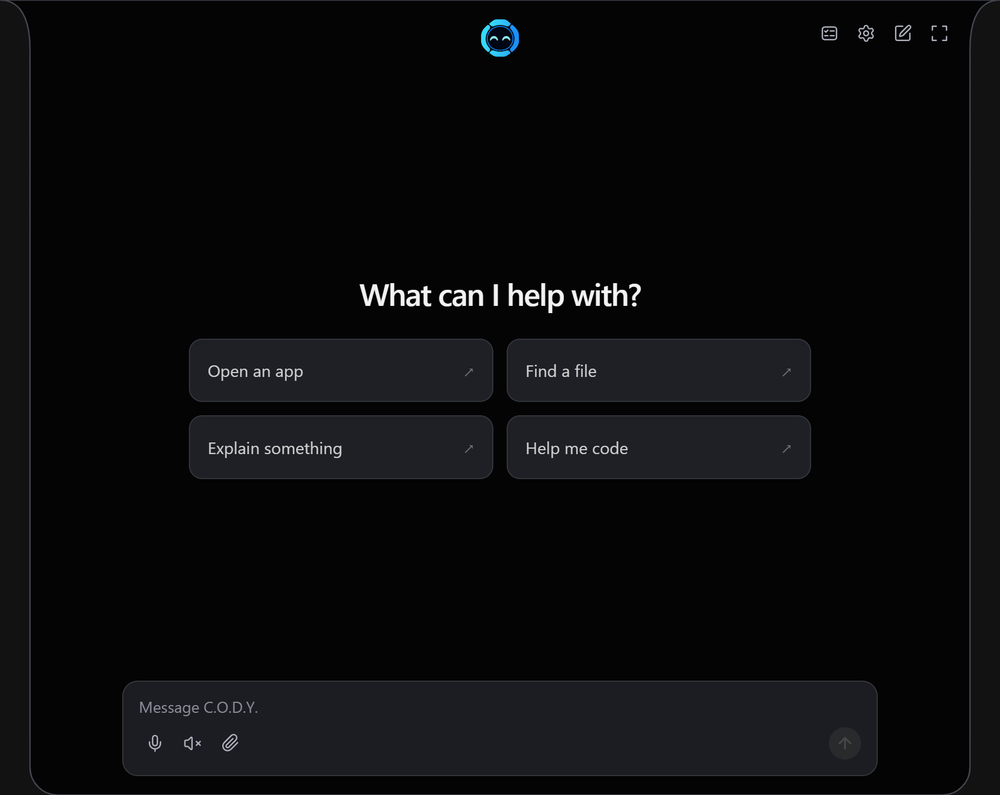

# C.O.D.Y. 0.15.6

## New controls and island widgets

- **Ctrl + Alt + M:** mute or unmute C.O.D.Y.'s voice input. A coral crossed-out microphone remains visible while muted; unmuting briefly shows a blue microphone with sound waves. Mute is saved across restarts and blocks C.O.D.Y. push-to-talk, wake detection, voice games, microphone tests and dictation. Other apps retain microphone access, and typed requests still work.
- **Persistent clock and weather:** say “show clock”, “show weather” or “show weather in Derby”. Pins survive restarts and rotate alongside RAM and the other monitors. The clock uses live local 24-hour time; weather refreshes every five minutes. Use “hide clock” or “hide weather” to remove a pin.
- **Windows settings commands:** turn Bluetooth or Wi-Fi on/off, check radio status, select a power mode, set supported display brightness, and open common Windows Settings pages. These use the existing computer-control permissions and a new Windows settings switch in Custom access.

## Fixes

- Recenter and resize expanded chat suggestions, align messages and the message box, and stack suggestions on narrow displays.
- Open the collapsed island on the first touchscreen tap, whether C.O.D.Y. is awake or asleep. Tapping outside collapses the panel.
- Show the drawing Clear button only while visible drawings or live models remain. Empty narration, empty canvases, hidden containers and invisible placeholders no longer keep it visible.

## Pictures

| Pinned clock | Pinned weather example |
| --- | --- |
|  |  |

| Microphone muted | Brief unmute indicator |
| --- | --- |
|  |  |

The updated illustrated Word guide and all seven screenshots are included as release assets. The weather picture uses an example reading.

## Install or update

Choose **C.O.D.Y-Setup-0.15.6-x64.exe** for Intel/AMD Windows PCs or **C.O.D.Y-Setup-0.15.6-arm64.exe** for ARM/Snapdragon Windows PCs. Some native components run as x64 on ARM Windows. Both installers remain unsigned.

Existing updater-enabled installations can use **Settings → Updates** to check, download and restart. Conversations and settings are preserved.

## Limits and validation

“Turn on power saver” selects **Best power efficiency** for the current power source; turning it off selects **Balanced**. The separate Windows Energy saver/Battery saver toggle opens its Settings page for manual adjustment. Radio controls depend on Windows access and hardware; brightness requires a Windows-managed display. Weather requires an internet connection.

Validation includes 332 JavaScript tests, native dictation and drawing-control regression tests, a successful native engine build, isolated live drawing-control checks, and Electron rendering checks for the new widgets and microphone indicators. Both Windows installer payloads are audited during packaging, and release checks verify their sizes and update-manifest checksums.

Native build prerequisites remain pinned to the verified 0.15.1 build-input archive.
