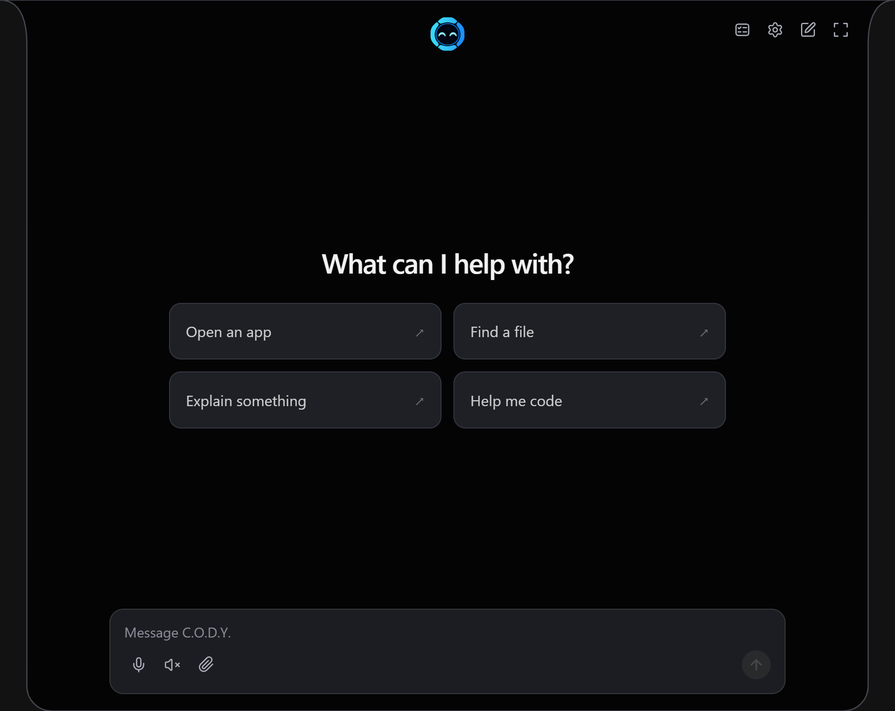
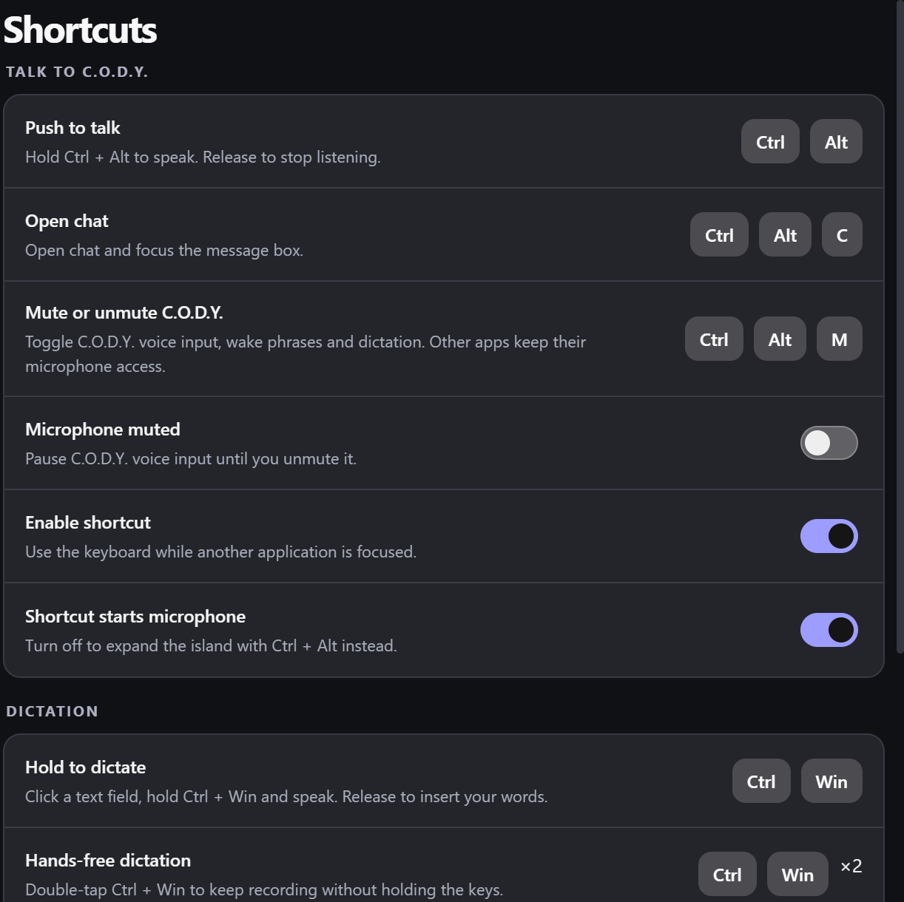
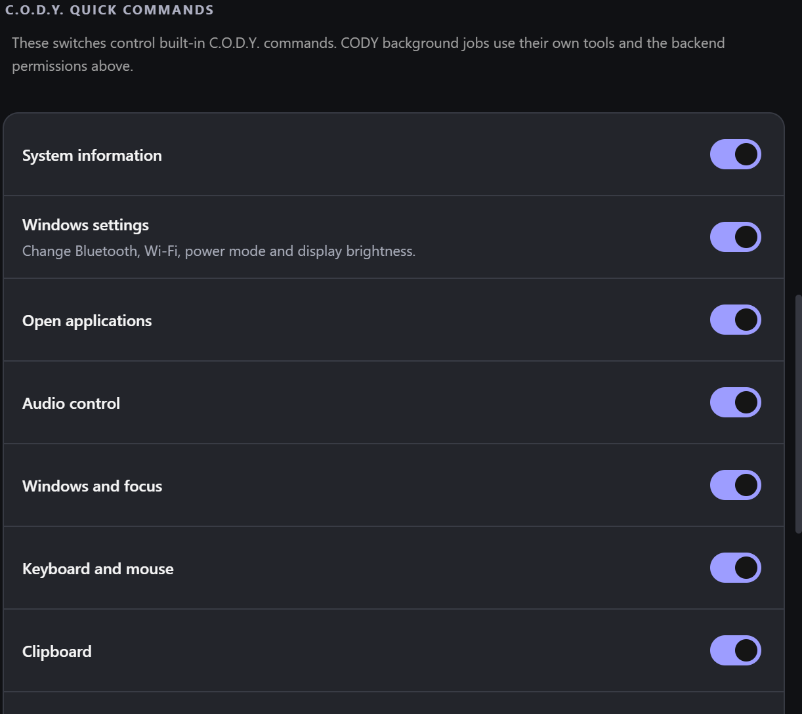

<p align="center">
  
</p>

<h1 align="center">C.O.D.Y.</h1>
<p align="center">A Windows desktop assistant for voice, conversation and getting things done.</p>
<p align="center">
  <a href="https://github.com/JNathan34/C.O.D.Y/releases/latest">Download for Windows</a> ·
  <a href="docs/GETTING-STARTED.md">Getting started</a> ·
  <a href="CODY-App/docs/GITHUB-UPDATES.md">Updates and releases</a> ·
  <a href="https://github.com/JNathan34/C.O.D.Y/issues">Report an issue</a>
</p>

C.O.D.Y. brings chat, voice controls and background tasks into an animated desktop island. It combines an Electron interface with a bundled Windows engine for computer controls, screen capture, browser connections and visual tools.

**Current release: 0.15.19 · Windows x64 and ARM64 · Early development**

## Install

1. Open the [latest release](https://github.com/JNathan34/C.O.D.Y/releases/latest).
2. Choose **C.O.D.Y-Setup-0.15.19-x64.exe** for Intel/AMD PCs or **C.O.D.Y-Setup-0.15.19-arm64.exe** for ARM/Snapdragon PCs. Each installer contains one application architecture.
3. Open C.O.D.Y., connect your preferred AI service and review the app permissions.

The installer is currently unsigned. Windows may show its publisher as unknown. AI providers require their own accounts; provider subscriptions and paid usage are not included.

Once this version is installed, **Settings → Updates** can check GitHub, download a newer release and restart to install it. Automatic checks run at startup and every six hours. You choose when to download and restart. Your conversations and settings stay in their existing profile.

## What you can do

- **Talk or type.** Use voice input, spoken responses and the desktop island, with local wake-word support.
- **Choose an assistant.** Connect Claude, ChatGPT Codex or ChatGPT. Some background tasks and attached-file requests still use the native Claude connection.
- **Work in the background.** Start tasks, inspect their progress and open their outputs.
- **Control Windows.** Use permission-controlled app, audio, window, clipboard, file and computer actions. Press **Esc** to stop computer control.
- **Change Windows settings.** Turn Bluetooth or Wi-Fi on/off, choose a power mode, set supported display brightness and open Settings pages. See the [commands and limits](docs/GETTING-STARTED.md#windows-settings-commands-in-the-current-source).
- **Capture your screen.** Take screenshots or record MP4 video, with pause and resume controls.
- **Connect a browser.** Set up the browser extension through the app. Browser actions require that connection.
- **Use visual tools.** Draw desktop annotations and work with interactive 3D scenes.
- **Keep everyday tools close.** Timers, media controls, weather and system monitors are available in the island.

Features depend on Windows permissions, account access and connected services. The [getting-started guide](docs/GETTING-STARTED.md) covers setup and current limits.

<a id="pictures-of-the-current-development-build"></a>

## Pictures of C.O.D.Y. 0.15.6

These pictures show the interface included in **0.15.6**, including the microphone shortcut, pinned clock/weather and Windows settings commands. The weather picture uses an example reading.



The expanded chat adjusts its suggestions and message box to the available space. Touchscreen input opens the island on the first tap and collapses it when you tap outside.

| Pinned clock and date | Pinned weather example |
| --- | --- |
|  |  |

Say **“show clock”**, **“show weather”** or **“show weather in Derby”** to keep an item in the island. Pins survive restarts and rotate alongside RAM and other monitors. Use **“hide clock”** or **“hide weather”** to remove them.

| Microphone muted | Brief unmute indicator |
| --- | --- |
|  |  |

**Ctrl + Alt + M** toggles C.O.D.Y. voice input, wake detection and dictation. The crossed-out microphone stays visible while muted; unmuting briefly shows blue sound waves. Other apps retain microphone access, and typed requests remain available.

| Updated Shortcuts page | Windows settings permission |
| --- | --- |
|  |  |

The new Windows settings permission covers Bluetooth and Wi-Fi on/off, power mode and supported display brightness. See the [command examples and limitations](docs/GETTING-STARTED.md#windows-settings-commands-in-the-current-source).

## Word guide

[Download the latest illustrated Word guide](https://github.com/JNathan34/C.O.D.Y/raw/refs/heads/main/docs/CODY-Complete-Capability-Guide.docx) · [Repository copy](docs/CODY-Complete-Capability-Guide.docx) · [Older release copy](https://github.com/JNathan34/C.O.D.Y/releases/download/v0.15.2/CODY-Complete-Capability-Guide.docx)

The handbook covers capabilities, voice commands, settings and setup, with screenshots and examples. The repository copy covers 0.15.13, including Discord commands, desktop FPS, the agent usage switch, local memory and recent settings changes. Older screenshots are labelled with their version where relevant.

The repository guide now includes refreshed Shortcuts and Permissions pictures plus current expanded-chat, clock, weather and microphone-status pictures. Weather is labelled as an example reading. Screenshot assets are in `docs/screenshots`; `CODY-App/tools/capture-guide-screenshots.cjs` captures the current renderer, and `CODY-App/tools/update-guide-pictures.py` embeds them using the document Python runtime.

## What changed in 0.15.19

- Discord gives shorter replies such as **“Muted”** and **“Unmuted.”** The Island animates a red slash on the microphone when Discord confirms mute and removes it when you unmute.
- Say **“Leave Discord”** or **“Disconnect from Discord”** to leave the current call or voice channel.
- Say **“Share screen”** for Discord’s Screen 1 or **“Share screen two”** for Screen 2. C.O.D.Y. now switches to **Entire Screen** in Discord’s source picker.

See [release notes](CODY-App/docs/RELEASE-NOTES-0.15.19.md).

## What changed in 0.15.18

- Discord commands show progress and results in the Island while your active window keeps focus.
- Say **“Discord screenshare”** to open the source picker.

See [release notes](CODY-App/docs/RELEASE-NOTES-0.15.18.md).

## What changed in 0.15.17

- FPS uses the same widget as weather, clock and RAM in the compact island and expanded chat.

See [release notes](CODY-App/docs/RELEASE-NOTES-0.15.17.md).

## What changed in 0.15.16

- Back up and restore local notes from **Settings → Memory → Memory Backup**.
- Improve quieter multi-word wake detection and the handoff into voice recognition.

See [release notes](CODY-App/docs/RELEASE-NOTES-0.15.16.md).

## What changed in 0.15.15

- The island folds smoothly into the top edge when hidden and fades panel controls before returning to the compact view.
- Find Island visibility under **Settings → Appearance → Island**.
- The pinned FPS counter sits inside the island alongside other status cards.

See [release notes](CODY-App/docs/RELEASE-NOTES-0.15.15.md).

## What changed in 0.15.14

- The island unfolds from the center of the top edge, rebounds, and fades in the mascot and any active details.
- Preview the motion from **Test all animations → Unfold / hide**.

See [release notes](CODY-App/docs/RELEASE-NOTES-0.15.14.md).

## What changed in 0.15.13

- Pause agent usage from Settings → Agents.
- Pin desktop FPS even when the current application has no frame-rate source.
- Mute, deafen and share a selected screen or window in Discord using typed or spoken commands.
- Save and manage encrypted notes on this PC under Settings → Memory.

See [release notes](CODY-App/docs/RELEASE-NOTES-0.15.13.md).

## What changed in 0.15.8

- Show update status and download progress in the island, with a shortcut to Settings → Updates.
- Restore normal chat size and pointer bounds when the expanded panel minimises, while preserving the conversation and draft.
- Keep the legacy native task dock hidden; background tasks remain available through C.O.D.Y.’s Tasks page.
- Include 3D window containment, aligned close controls and 10× scroll zoom.

See [release notes](CODY-App/docs/RELEASE-NOTES-0.15.8.md).

## What changed in 0.15.6

- Toggle C.O.D.Y.-only microphone mute with **Ctrl + Alt + M**, with persistent mute and brief unmute indicators.
- Pin a live clock and current weather alongside RAM and other island monitors.
- Control Bluetooth, Wi-Fi, power mode and supported display brightness through permission-checked commands.
- Improve touchscreen first-tap opening, outside-tap dismissal and expanded chat layout.
- Keep the drawing Clear button hidden when there is no visible content to clear.
- Refresh the illustrated Word guide and screenshots.

See [release notes](CODY-App/docs/RELEASE-NOTES-0.15.6.md) and the [changelog](CHANGELOG.md).

## What changed in 0.15.5

- Hold **Ctrl + left-drag** to move 3D models, including models with transparent backgrounds.
- Normal dragging still rotates models, and scrolling still zooms them.
- Moved models retain their placement and stay reachable at screen edges.
- The chat panel stays above 3D models without flickering between the two.

See [release notes](CODY-App/docs/RELEASE-NOTES-0.15.5.md) and the [changelog](CHANGELOG.md).

## Develop

Requirements: Windows, Git, Node.js 24, Python 3.11 or later, and the .NET 10 SDK. The native projects target Windows and .NET 9 with C# 14.

```powershell
git -c core.longpaths=true clone https://github.com/JNathan34/C.O.D.Y.git
cd C.O.D.Y\CODY-App
npm ci --ignore-scripts
node node_modules/electron/install.js
powershell -NoProfile -File tools/restore-build-inputs.ps1
.\Build-Engine.bat
.\Start-Development.bat
```

The restore command downloads the versioned native runtime and installer prerequisites from the pinned release and verifies their SHA-256 checksum before extraction. Large runtime files are release assets rather than Git history. The native build also downloads pinned wake-word dependencies and verifies their checksums.

Run the frontend checks with:

```powershell
cd frontend/original-cody
npm test
```

Return to `CODY-App` and run `Build-CODY-Standalone.bat` to build the native engine and package both Windows architectures. Close the development app before rebuilding its engine.

| Location | Contents |
| --- | --- |
| `CODY-App/frontend/original-cody/` | Current Electron app, interface, assets and tests |
| `CODY-App/work/Cody.*` | Native Windows project sources |
| `CODY-App/tools/` | Build, release and verification tools |
| `CODY-App/build/installer/standalone.nsh` | Windows installer integration |
| `docs/` | Setup, architecture and development guides |

[Developer details](CODY-App/README.md) · [Release workflow](CODY-App/docs/GITHUB-UPDATES.md) · [Security](SECURITY.md)

## Project status and credits

C.O.D.Y. is an independent project, not an official OpenAI, Anthropic or HeyClicky product. Its Windows engine includes recovered HeyClicky-derived components alongside C.O.D.Y. integrations. Third-party components, assets, models and services retain their respective rights and terms.

No blanket licence is granted by this repository's public visibility. Package-specific licence fields apply only within their stated scope; they do not relicense third-party or recovered components. Keep applicable notices when working with the source or packaged dependencies.
